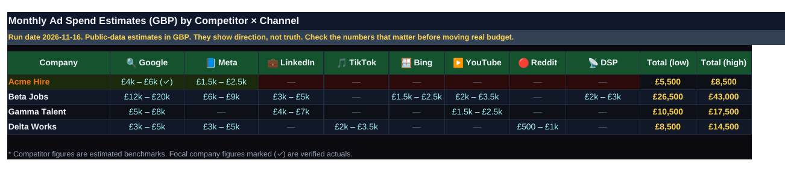

# Competitor analysis skill

An open skill that turns a **company name** and **three competitors** into a competitor ad intelligence dashboard in Excel, built by a script so it looks the same every time.



## What the dashboard contains

1. **Overview**: every company side by side, with positioning, strength, weakness and active channels
2. **Your company's actuals**: your own performance by channel, clearly marked as estimated or verified
3. **Budget estimates**: monthly spend ranges per competitor per channel, with totals
4. **CPL estimates**: cost per lead per competitor per channel, colour-coded against benchmarks
5. **Channel benchmarks**: category budget and CPL ranges for Google, Meta, LinkedIn, TikTok, Bing, YouTube, Reddit and DSP
6. **Competitor profiles**: angle, ad copy, targeting, creative and CTA for each competitor on each channel
7. **Remarketing**: audiences, tactics, messages and offers per competitor per channel
8. **Opportunities**: 6 to 9 prioritised actions (Immediate, 30-Day, 60-Day)

The figures are estimates built from public ad-library data. They show direction, not truth. They are very useful for generating ideas and for understanding competitor messaging. Give the skill one real number from your own data and the estimates improve.

## Why the result is the same every time

The agent does the research and writes a JSON file. A fixed script, [`build_dashboard.py`](skills/competitor-analysis/scripts/build_dashboard.py), builds the workbook from it. The layout, colours, column widths and tab order live in that script, not in the agent's memory, so every agent and every run produces the same look.

## Install

Copy the skill folder into your agent's skills folder. Copy the **whole folder** (it contains the script and reference files, not only `SKILL.md`).

| Agent | Where it goes |
|---|---|
| Claude Code | `~/.claude/skills/` or `.claude/skills/` in your project |
| Claude (claude.ai) | Zip the `competitor-analysis` folder and upload it under Settings, Capabilities, Skills |
| Codex | `~/.agents/skills/` or `.agents/skills/` in your project |
| Any other agent | Point it at `AGENTS.md`, or paste `SKILL.md` into the chat or project instructions and make the folder available |

Folder locations differ between tools and change over time, so check your agent's documentation.

**Requirement:** the agent must be able to run Python 3.8 or later with `openpyxl` (`pip install openpyxl`). If it cannot run code, it will give you the JSON file and the one command that builds the dashboard.

## Use

Ask in plain language:

> Run a competitor analysis for Acme. Competitors: Beta, Gamma, Delta.

If you do not name competitors, the agent picks the 3 to 4 most direct ones and tells you why. Optional: add your market and one real number from your own data, such as your cost per lead.

## Try the script without an agent

```bash
pip install -r requirements.txt
python skills/competitor-analysis/scripts/build_dashboard.py \
  skills/competitor-analysis/templates/input.example.json -o example.xlsx
```

The example uses fictional companies. A ready-built copy is in [`examples/`](examples).

## Limits

- Estimates only. A person with judgement should check the numbers that matter before real budget moves.
- Quality depends on the agent being able to browse public ad libraries. Where it cannot, it should say so and mark values "not available" rather than guess.
- Competitor analysis goes out of date quickly. Re-run it regularly.

## Contributing

Improvements are welcome: new channels, sources, extra tabs, translations. Change the style in `build_dashboard.py` only, and keep `SKILL.md` short and free of company-confidential data.

## Licence

MIT. See [LICENSE](LICENSE).
